# Assignment 2: Command Injection in a Web Application
---

**Environment:** Kali Linux

## Overview

This task involved building a simple web app that runs a network ping command, demonstrating how it can be misused through **command injection**, and then fixing the vulnerability.

Command injection occurs when a web application passes user input directly to the system shell without proper validation. This can allow attackers to run additional commands beyond the intended one. If exploited, it may lead to unauthorised access to files, data theft, or damage to the system.

The task was completed in four stages: building the vulnerable application, testing the attack, fixing the vulnerability, and verifying that the fix works correctly.

---

## Step 1: Build and run the vulnerable ping tool

First I made a project folder and set up a Python virtual environment (a clean, isolated space to install Flask without touching the rest of the system).

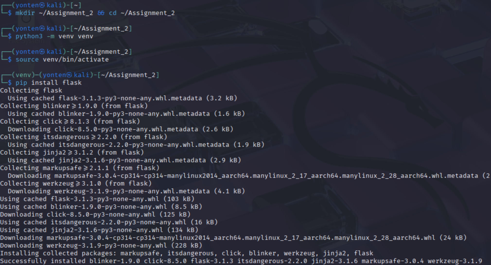
*Figure 1: Creating the project folder and virtual environment on Kali.*

Then I wrote `app.py` a Flask app with a single text box that pings whatever host you type in and started it.

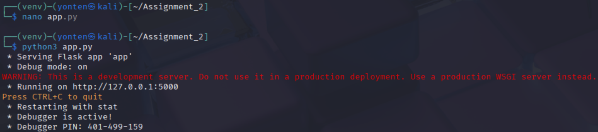
*Figure 2: The vulnerable Flask app running locally.*

I opened `http://127.0.0.1:5000` in the browser, typed `127.0.0.1`, and clicked **Ping**. The normal ping replies came back, so the app works as intended.

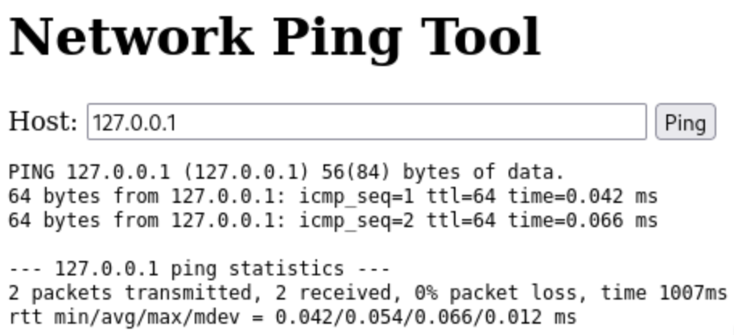
*Figure 3: Normal use the app pings 127.0.0.1 and shows the result.*

**Why the application is vulnerable?:** 
- The app adds the user's input to a command like `ping -c 2 host` and runs it through the shell. Special characters like `;`, `|`, and `&&` can be used to run extra commands. So this makes the app vulnerable to command injection.

---

## Step 2: Exploit it (command injection)
Now in here i will test the app by entering an extra OS command instead of just an IP address. So, in here instead of running just an IP address, I type a shell separator followed by my own command. the seperator will help me run the ping first, then runs my command right after it.

**Payload 1: chaining with `;`** → `127.0.0.1; whoami`

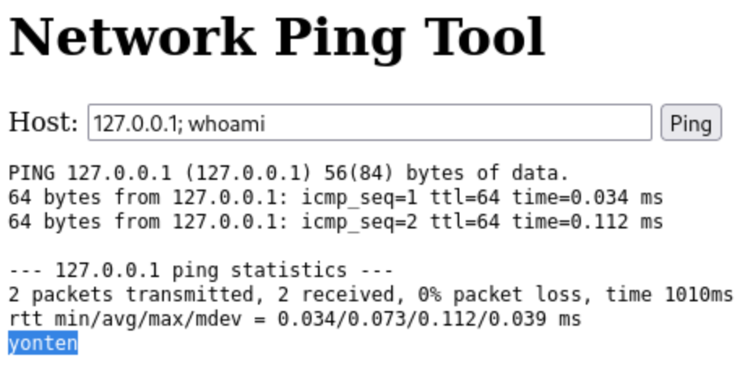
*Figure 4: The `whoami` command runs and prints the account the web server is using. This proves my own commands are executing, not just ping.*

**Payload 2: reading a sensitive file** → `127.0.0.1; cat /etc/passwd`

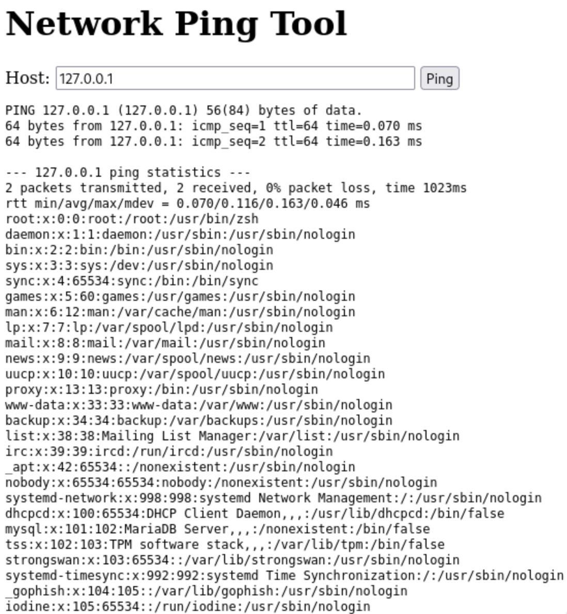
*Figure 5: The app dumps `/etc/passwd`, the system's user list an attacker can read files through the form.*

**Payload 3: pipe operator `|`** → `127.0.0.1 | id`

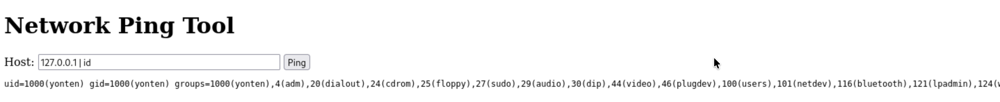
*Figure 6: Injection also works with `|`, printing user and group IDs. More than one shell character is exploitable.*

**Payload 4: chaining with `&&`** → `127.0.0.1 && uname -a`

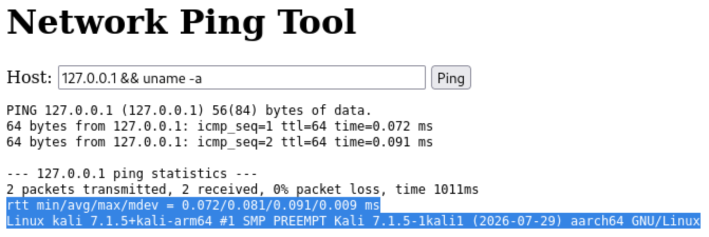
*Figure 7: `uname -a` leaks the OS and kernel version useful recon for an attacker planning the next move.*

### Summary of this step
Since the app sends user input directly to the shell, special characters like `;`, `|`, and `&&` can be used to run extra commands. For example, `127.0.0.1; whoami` runs the ping command first and then shows which account the server is using. Other tests using `id`, `uname -a`, and `cat /etc/passwd` also worked. This confirms an **OS command injection** vulnerability, which could allow attackers to access sensitive information or harm the system.

---

## Step 3: Fix (safeguards)

I rewrote the app with two layers of protection. Either one stops the attack; using both is "defence in depth" if one fails, the other still holds.

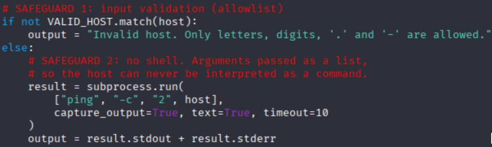
*Figure 8: The secured `app.py` with both safeguards in place.*

### Summary of this step

**Safeguard 1: Input validation (allowlist).** I added a rule that the host field may only contain letters, digits, dots and hyphens the regular expression `^[A-Za-z0-9.-]+$`. A real hostname or IP never contains `;`, `|`, `&` or spaces, so any input with those characters is rejected before anything runs.

**Safeguard 2: Remove the shell.** Instead of building one big command string, the app now calls `subprocess.run(["ping", "-c", "2", host])` with the arguments passed as a list and `shell=False`. With no shell involved, there's nothing to interpret `;` or `|` as special the host value is always handed to `ping` as a single plain argument, never as a command of its own.

Together these follow the standard OWASP advice: don't call the OS shell directly, and validate all input against an allowlist. I confirmed a normal ping still works after the change, so the feature isn't broken just safe.

---

## Step 4: Verify the fix (re-run the same attacks)

To prove the fix actually works, I tried the exact same payloads from Step 2 against the hardened app.

**Payload 1 (was `;`)** → `127.0.0.1; whoami`

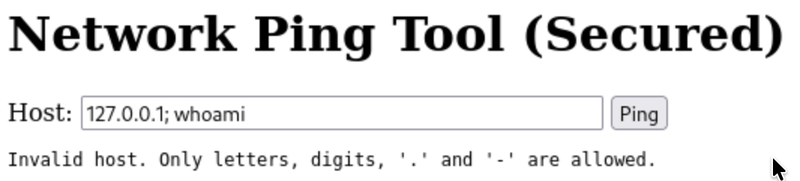
*Figure 9: The same `;` payload from Figure 4 is now rejected by input validation `whoami` never runs.*

**Payload 2 (was file read)** → `127.0.0.1; cat /etc/passwd`

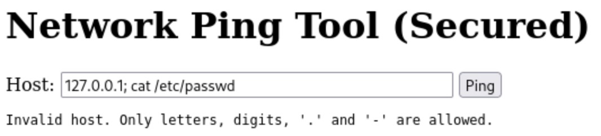
*Figure 10: The `cat /etc/passwd` payload is blocked no file contents are shown.*

**Payload 3 (was `|`)** → `127.0.0.1 | id`

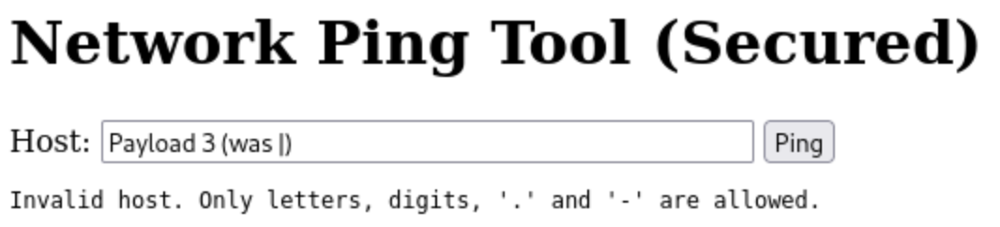
*Figure 11: The `|` payload is rejected the pipe and spaces fail the allowlist.*

**Payload 4 (was `&&`)** → `127.0.0.1 && uname -a`

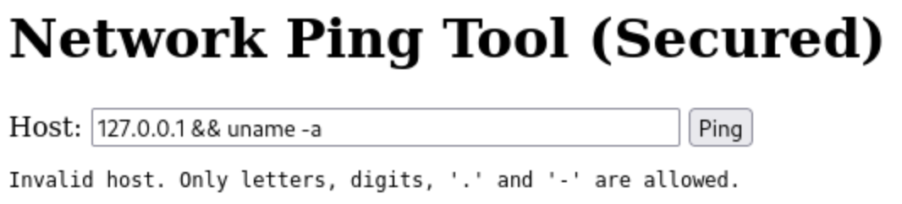
*Figure 12: The `&&` payload is also blocked no kernel information leaks.*

**And finally, confirm normal use still works** → `127.0.0.1`

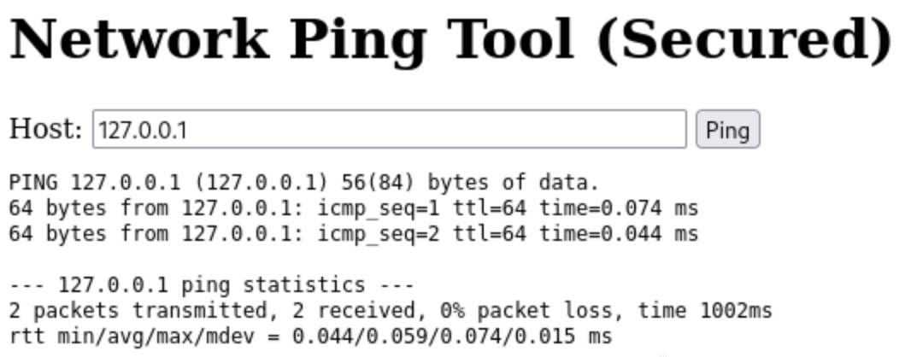
*Figure 13: A legitimate ping to 127.0.0.1 still succeeds the fix blocks attacks without breaking the real feature.*

### Summary of this step

Every malicious payload that worked before is now rejected, and no injected command executes so the vulnerability is fixed. At the same time, a normal ping still runs fine, which shows the safeguards protect the app without getting in the way of legitimate use.

---

## Conclusion

The ping tool started out vulnerable to OS command injection because it passed user input directly to the system shell. By adding allowlist input validation and removing the shell entirely (`shell=False`), I closed the hole while keeping the app working normally. This maps to **OWASP A03:2021 Injection**, and the before-and-after tests confirm the attack is no longer possible.

